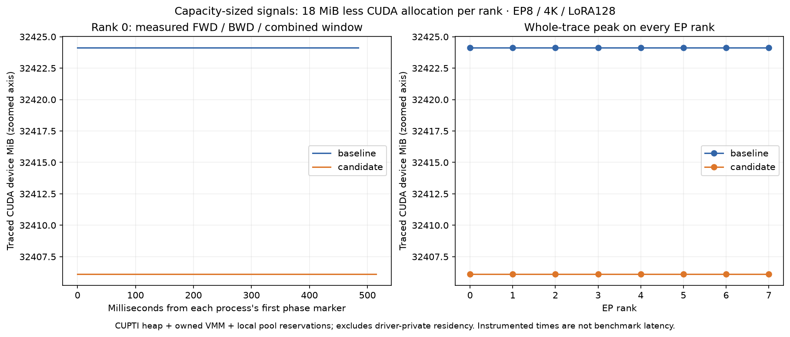

# Capacity-sized MegaMoE synchronization signals

The ordinary MegaMoE workspace previously reserved 20 MiB of routed ring signals
and 128 KiB of shared-expert signals at every capacity. Those fixed arrays also
rejected capacities above their bounds. Size the signal regions from the existing
ring and context capacities, with independent 128-byte alignment. Keep the
control/expert prefix fixed and place token metadata after the complete signals.
The side-LoRA low-word counter follows the ordinary mask accessor.

The scheduler, ring safety bound, kernel arithmetic, and active-length policy are
unchanged. Rebuild both the host extension and device kernels together: this is
an internal workspace-layout change, not a compatible layout for mixed binaries.
No model/checkpoint format or public Python signature changes.

## EP8 B300 measurement

H3584/I3072/E896/top16; 4,096 tokens per rank; shared LoRA128; real MXFP4 frozen
storage decoded/merged to BF16 expert operands. Forward includes the merge;
backward includes factor gradients and shared-factor reductions. This is the
composed training path, not the native MXFP4 tensor-core expert path.

Four clean fresh-process ABBA blocks, ten warmups and thirty samples per phase
per block. Each sample uses the slowest rank; each variant has sixty samples.
Memory is from separate clean captures with two warmups and three samples per
phase. All sixteen allocation traces have zero accounting errors/dropped records.

| Phase | Before ms | After ms | Allocated GiB before / after | Reserved GiB before / after | Traced CUDA GiB before / after |
|---|---:|---:|---:|---:|---:|
| Forward | 32.4566 | 32.5074 | 11.446 / 11.446 | 26.283 / 26.283 | 31.664186 / 31.646607 |
| Backward | 11.4432 | 11.3581 | 11.997 / 11.997 | 26.283 / 26.283 | 31.664186 / 31.646607 |
| Combined | 43.2703 | 43.1461 | 11.997 / 11.997 | 26.283 / 26.283 | 31.664186 / 31.646607 |

The traced device peak drops by **18 MiB per rank**. No speedup is claimed from
the sub-percent combined timing difference. Instrumented process-lifetime RSS is
4,347,883,520 → 4,349,394,944 bytes (+1.441 MiB). Whole-trace CUDA-pinned peak is
2,097,152 → 2,097,152 bytes; each measured phase peaks at 1,179,664 bytes.
These host/pinned metrics are per-process maxima over ranks, not summed host RAM.



The picture reconstructs process-owned CUDA heap, nonduplicated VMM and observed
local pool reservations. It excludes driver-private residency, RDMA-only/non-CUDA
host pins and static-symbol residency. The ordinate is zoomed to expose the small
allocation change. Each process's first phase marker is its own time origin;
horizontal differences are not accepted benchmark latency.

CPU review: no new Python calls or host synchronization; constructor capacity
arithmetic and pointer-offset calculations replace fixed offsets. GPU review:
only layout accessors change, with no added kernel launch, barrier, fence, or
collective. The ABBA measurement checks the resulting compiled-path overhead.

## Correctness and limits

- The committed CPU test compiles the actual ordinary and side-LoRA workspace
  accessors. Five cases check alignment, nonoverlap, both ends of each region,
  prefix/tail canaries, low-word aliasing and every supported block-M candidate.
  Cases include both former limits, one beyond each, and the 256K context layout.
- 112 production EP8 rank/backend/case records pass strict cosine >0.99999 for
  output, input/score gradients and all six factors; minimum MegaMoE cosine is
  0.9999966743992496. Zero references require exact equality. Repeated forwards
  are bitwise equal. Physical lengths include unequal, odd, empty, one-row,
  boundary and all-masked inputs. Host diagnostics overlapped this numerical run;
  it contributes no accepted performance/memory measurements.
- Every rank starts with a fresh native cache. Eight cubins per rank are compiled
  at warmup; hashes stay unchanged across later lengths, with zero later external
  compiler executions. This proves reuse within capacity 1024, not across context
  capacities. Triton used an existing cache.
- The separate 40-record dispatch oracle passes at H2048/I256, E896/top16. Its
  run also overlaps host diagnostics and supplies numerical evidence only.
- 256K passes the old signal assertions but still OOMs on saved gate/up activations.
  The unchanged ring plus saved-forward lower bound is 309.378 GiB before weights
  and runtime overhead. This patch does not qualify 256K operation, all-length
  memory, full-model CP/checkpoint/offload, or every native precision path.

## Reproduction and provenance

CPU canaries need only Python and a C++17 compiler:

```bash
python3 -m unittest discover -s tests -p test_mega_moe_signal_layout.py -v
```

Measurement base: `a4656659c8099ed0208ab193fc3c22c3e1f90096`, the explicit-options
draft [#36](https://github.com/fw-ai-external/DeepGEMM/pull/36). Both runtime
packages also apply the separate expert-prefix correction
[#35](https://github.com/fw-ai-external/DeepGEMM/pull/35). Only the two layout
headers and rebuilt extension differ between the matched native packages.
The composed trainer is `aa0cd94de7ecea5c07b121a5f94f74967825177e`.
Candidate wheel SHA256:
`9065ec9fc38d697ade8422493e743ce0b4ce2e6a508f07f07c4aef5bd3c94363`.

Exact source pins, commands, per-rank results and monitors are retained on the
measurement host under the study workspace. Reproduction recipes:

- `/data/yued/moe-study/setup/build-dynamic-signals.py`
- `/data/yued/moe-study/setup/qualify-dynamic-signals-v2.py`
- `/data/yued/moe-study/setup/qualify-dynamic-signals-memory-v2.py`
- `/data/yued/moe-study/setup/time-dynamic-signals-abba.py`

The recipes pin dependencies, check GPU availability and reject overlapping
performance captures. They refuse to overwrite evidence; use fresh output paths
for reruns. The production harness is currently local to the larger study; the
CPU canary test is self-contained. This remains a draft pending broader integration.
