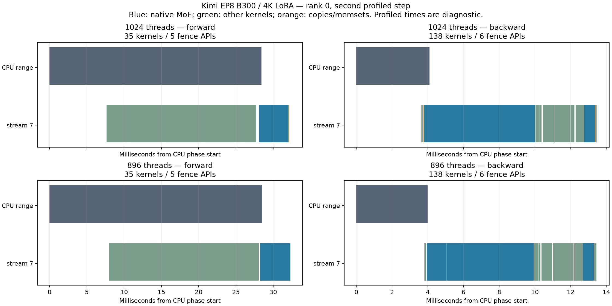

# Kimi EP8 BF16 backward: 896-thread policy

The guarded Kimi-K3.1 BF16 dgrad launch uses 896 total threads instead of 1024.
The kernel's compiled total-thread argument comes from the launch block size,
so barrier participation and strided work coverage use the same dimension.
The 128 producer threads and 128 TMEM-loader threads are unchanged. The
remaining epilogue threads decrease from 896 to 768. Other paths retain 1024.

The guard requires SM103, H3584/I3072, 112 local experts, EP8/top16, block M240,
SiTU/fast math, phase-ordered memory, post-down routing, DeepEP combine order,
separate W3, direct remote grad-x without a local grad-x pool, cleared wgrad
padding, vectorized stores and no wide stores. There is no new environment
flag or Python API. Token lengths do not select the policy.

This is stacked on explicit-options commit
`2ba98dbcfa3f2712ec07ff04c8a066f5ae843bff`
([PR36](https://github.com/fw-ai-external/DeepGEMM/pull/36)). The validated
native stack includes the separate expert-prefix correction from
[PR35](https://github.com/fw-ai-external/DeepGEMM/pull/35).

## Matched operator timing

8x B300, EP8, H3584/I3072/E896/top16, shared LoRA128. Frozen native-MXFP4
storage with BF16 expert arithmetic. Both arms use the same qualified Gluon
weight merge, direct gate/up packing and corrected 65536-row shared-factor
reduction. Forward includes merging; backward includes all factor gradients.
Only the native CTA policy differs. Four clean fresh-process ABBA blocks per
capacity, 10 warmups and 30 slowest-rank samples per phase per block.

| Tokens/rank | Forward ms before → after | Backward ms before → after | Backward change | Combined ms before → after |
|---|---:|---:|---:|---:|
| 4K | 24.688975 → 24.629248 | 10.451360 → 10.199392 | −2.411% | 34.420706 → 34.308367 |
| 8K | 28.555168 → 28.448193 | 16.371248 → 16.030480 | −2.082% | 45.070448 → 44.647200 |
| 16K | 37.599489 → 37.930048 | 31.894849 → 31.309072 | −1.837% | 69.498913 → 69.070126 |

Both backward process pairs improve at every capacity. At 16K, forward is
0.879% slower; combined improves 0.617% pooled but one pair is slightly slower.
Samples within a process are correlated; this is two process replications per
arm, not 60 independent replications. The 1.3x backward target against matched
DeepEP remains unmet. Gains from earlier optimizations must not be added to
these percentages.

## Numerical and memory gates

336 strict rank/backend/case records pass across 4K/8K/16K, covering seven
changing physical-length cases at each capacity: warmup, unequal, odd, empty
rank, one token, boundary and all masked. Output, input/score and all six
factor gradients have cosine strictly above 0.99999; zero references require
exact equality. Repeated forwards are bitwise equal. Modified kernels do not
compile after warmup. Every rank's actual generated executable and resource
counts match the offline candidate. In each timing quartet, all nine tensor
byte digests agree across all four blocks on all eight ranks.

Independent clean memory captures use two warmups and three instrumented
samples per phase. Allocated, reserved, traced owned-CUDA and CUDA-pinned
peaks are identical before/after in every phase at all three capacities.
Instrumented timings are excluded.

| Tokens/rank | Traced CUDA GiB before/after | CUDA pins MiB before/after | Host RSS GiB before → after |
|---|---:|---:|---:|
| 4K | 31.664186 / 31.664186 | 1.125015 / 1.125015 | 4.059162 → 4.067913 |
| 8K | 34.668092 / 34.668092 | 1.125015 / 1.125015 | 4.066303 → 4.070316 |
| 16K | 40.646607 / 40.646607 | 1.125015 / 1.125015 | 4.068047 → 4.068497 |

Host RSS is a process-lifetime maximum. Driver-private residency and
non-CUDA/RDMA pins are excluded. These are operator gates; they do not close
production-length full-model CP/checkpoint/offload integration or broader
capacity qualification. The guard also applies to larger token capacities,
which remain an explicit draft limitation.

## Diagnosis and competing candidate

The measured kernel uses 72 registers per thread versus 64 in the parent;
static stack decreases from 408 to 80 bytes. Runtime NCU local-load requests
increase from 164.463 to 252.808 MB while local stores decrease from 144.462
to 111.923 MB. Thus reduced runtime spilling is not an established explanation
for this gain. The no-instruction/issued-instruction ratio changes
0.367813→0.350823 and instruction-cache tag misses fall 284,180→218,119.
These are separate GPU0 diagnostic captures, not paired latency or HBM bytes.

The 768-thread trial eliminates measured local-load/store requests but gives
smaller backward reductions: 1.291%/1.463%/1.350% at 4K/8K/16K; its 8K
combined latency increases 0.355%. The two trials have separate parent
cohorts. Choosing 896 is an engineering decision based on the measured
backward direction, not proof of statistical superiority in a direct trial.

Prior work: [FIR2-3186](https://linear.app/fireworks/issue/FIR2-3186) owns both
CTA trials; the separate compact-traversal trial
[FIR2-3185](https://linear.app/fireworks/issue/FIR2-3185) is excluded.
[PR33](https://github.com/fw-ai-external/DeepGEMM/pull/33) contains earlier
rejected W13 worker-count/pipeline experiments at different shapes. No
arithmetic, traversal, buffers, barriers or store mapping changes are included.

## CPU, launch and fence evidence

The source review finds only host metadata comparisons and explicit existing
template arguments. No Python call, allocation, kernel launch or fence is
added. Both runtime-generator callers set a block dimension; the FP8 caller
retains 1024, equal to the original template defaults.

Two whole-job-clean production-overlay Kineto captures now pass. Across 48
matched rank/step/phase comparisons, the audit finds no unexpected kernel,
copy, launch or fence-count differences, and collective/fence order agrees.
The native backward-wave template and block dimension alone change
1024→896, with 64→72 registers/thread and the same 148-block grid.
All nine first-warmup tensor digests match the accepted timing runs on every rank.

Forward has 35 kernels/35 launch APIs/5 fence APIs in both arms; backward
has 138/138/6. Median profiled CPU ranges are 29.926448→29.707180 ms
forward and 4.146256→4.247111 ms backward. Median backward CUDA API union
is 0.708144→0.705327 ms. These instrumented ranges include profiler and
synchronization effects; the small CPU-range increase is retained, not used
as an unprofiled CPU-overhead estimate. The separate ABBA runs establish the
operator timing result. The first earlier acquisition was rejected for
foreign diagnostic overlap and remains excluded.

[Evidence summaries and raw-result checksums](kimi-bf16-backward-cta896-evidence.json)
retain every capacity's numerical, timing and memory gates plus this trace audit.

## Reproduction

The exact production harness and raw data are retained on b300-devhost-5 at
`/home/yued/.codex/worktrees/kimi-k31-moe-study/fireworks/`. Each profile root
contains `harness/`, `analysis/provenance.json` with source/package SHA256 pins,
and `reports/*/run-state.json` with the exact monitored GPU command. Replay
with the launcher's recorded environment and a new output directory, after
checking GPU availability. Do not modify the frozen qualification inputs.

- `profile/native-dgrad-cta896-qualification-ep8-{4,8,16}k-01`
- `profile/native-dgrad-cta896-screen-ep8-{4,8,16}k-01`
- `profile/native-dgrad-cta896-memory-ep8-{4,8,16}k-01`
- `profile/native-dgrad-cta896-ncu-4k-reviewed-04`
- `profile/native-dgrad-cta896-trace-ep8-4k-02` (the original `-01` capture was excluded for overlapping diagnostics)

The report directory retains independent collectors for each capacity.
For 4K, use `collect_native_dgrad_cta896_qualification.py --tokens 4096`,
`collect_native_dgrad_cta896_screen_v2.py`, and
`collect_native_dgrad_cta896_memory.py --tokens 4096`.
For 8K/16K, use `collect_native_dgrad_cta896_qualification_short.py --tokens 8192`
or `16384`, plus the respective `collect_native_dgrad_cta896_screen_{8,16}k.py`
and `collect_native_dgrad_cta896_memory_{8,16}k.py` collectors.
`collect_native_dgrad_cta896_trace.py` audits the paired trace. Run these with
`/data/yued/moe-study/venv-report/bin/python` from the study checkout.
The GPU harness is study-local; a complete portable bundle remains part of
the broader study.
