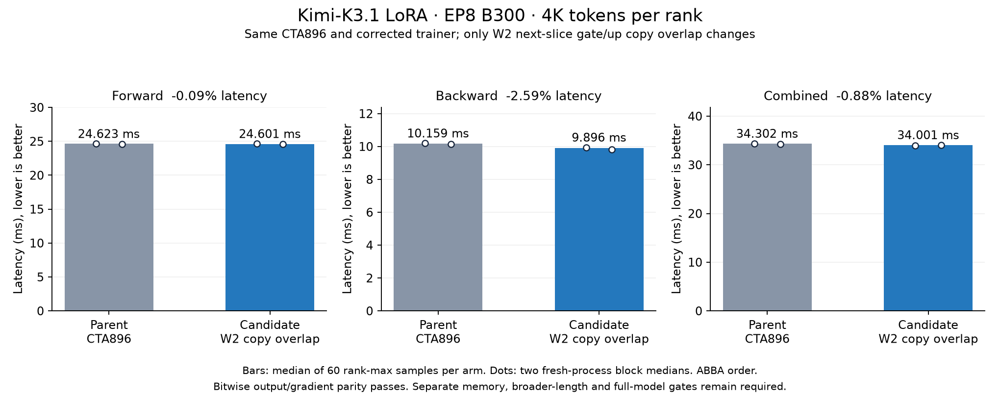

# Kimi W2 next-slice gate/up copy overlap

This draft overlaps the next W2 gate/up slice's asynchronous copies with the
current slice's activation and output stores. Against the selected CTA896
parent, 4K EP8 backward latency decreases **2.588%** and combined latency
decreases **0.877%**, with unchanged measured allocation-memory peaks.
8K/16K and production integration remain open.

Parent: `4b95935af13c4723d585033dfa27c5e3cc4148ce`,
[CTA896 draft PR2](https://github.com/yoyoyocmu-fw/DeepGEMM/pull/2).
This patch builds on current-slice staging from
[PR28](https://github.com/fw-ai-external/DeepGEMM/pull/28).
It adds no Python API or environment flag.

## Storage and synchronization

The compile-time guard requires staged gate/up, prepared inputs and dispatch,
SiTU, H3584/I3072 and at least 8192 bytes of reserved dispatch storage.
Under this prepared BF16 path, both existing prefix users (dequantization and
dispatch pull) are compiled out. At the measured EP8 configuration, the extra
gate/up pair uses 8 KiB within the existing 28 KiB prefix; mainloop storage
starts after the prefix. The explicit allocation size does not change.

The existing output/scale storage is slot zero and the prefix is slot one.
The first slice is copied after the existing initial row barrier. Each slice
waits for its copy group and joins the epilogue workers before reading. After
that join, workers issue the following slice into the alternate slot, then
compute the current slice. The last slice issues no following copy. Existing
row barriers protect TMEM and staging-slot reuse. Arithmetic, rounding, output
stores, W13 and the 768 epilogue workers are unchanged in the tested path.

The guard is not limited to EP8 or a token capacity. Other eligible EP/thread
configurations and larger lengths are unqualified; this remains a draft.

## Measured 4K operator results

Eight B300 GPUs, H3584/I3072/E896/top16, shared LoRA128, frozen MXFP4 storage
and **BF16 expert arithmetic**. Both arms use the same Gluon merge, direct
gate/up packing and corrected 65536-row shared-factor reduction.
Four whole-job-clean fresh-process ABBA blocks, ten warmups and thirty
slowest-rank samples per phase/block. All nine output/gradient tensors agree
bitwise across every block on all eight ranks. One earlier parent attempt
overlapped foreign work near timed intervals and remains excluded.

| Phase | CTA896 parent ms | Copy overlap ms | Latency change |
|---|---:|---:|---:|
| Forward | 24.623089 | 24.601152 | -0.089% |
| Backward | 10.159360 | 9.896448 | -2.588% |
| Combined | 34.302401 | 34.001472 | -0.877% |

Backward pair speedups are 1.02535x and 1.03265x; combined pair speedups are
1.01241x and 1.00404x. Forward pairs straddle parity. Separate phase medians
are not additive. Two processes per arm do not establish statistical
non-inferiority, and these results are not a new matched DeepEP/dist_moe sweep.



Separate whole-job-clean memory captures use two warmups and three
instrumented samples per phase. Their timings are excluded.

| Peak across phases | Parent | Copy overlap |
|---|---:|---:|
| PyTorch allocated GiB | 11.997145 | 11.997145 |
| PyTorch reserved GiB | 26.283203 | 26.283203 |
| Traced CUDA GiB | 31.664186 | 31.664186 |
| CUDA-pinned MiB | 1.125015 | 1.125015 |
| Host RSS GiB | 4.064865 | 4.065044 |

Host RSS is a process-lifetime maximum. CUDA tracing excludes driver-private
residency and non-CUDA/RDMA pins. Separate post-phase samples of device usage
minus PyTorch reserved memory are identical at 6599.875 MiB in both memory
arms. These are sampled points, not continuous driver-private peaks.

## Qualification and remaining gates

- All 112 reference qualification records pass: minimum cosine
  0.999996563938608, exact-zero checks, repeated bitwise forwards, uneven/odd/
  empty/one-token/boundary/all-masked inputs and zero modified-kernel compilation
  after warmup. Output, input, score and all six factor gradients are checked.
- All sixteen actual warmed parent/candidate executables match their offline
  template, SASS and resource reports. Registers remain 72; stack increases
  80 to 88 bytes. Ptxas spill-store/load reports increase 1248/1496 to
  1976/2864 bytes. Static LOCAL0 does not imply zero spills. Whole-kernel
  static LDL/STL counts increase 374/331 to 716/513; these are not executed
  traffic or source-stage attribution.
- The committed CPU check evaluates extracted C++ guard/copy/getter expressions
  across 11,568 cases and 44,421,120 sixteen-byte vectors, plus 935 abstract
  warp schedules. Six negative controls detect missing barriers, waits/copies,
  cross-tile reuse and undrained final groups. This does not prove hardware
  ordering or liveness; GPU qualification remains required.

Open: 8K/16K timing and memory after their numerical/executable qualification;
larger capacities; paired production traces and NCU follow-up; production-length
CP boundaries, checkpointing and offload with collective-order validation;
other configurations admitted by the guard. The requested 1.3x backward gain
over matched DeepEP remains unmet. Do not promote this from the 4K result alone.

## Reproduction

The CPU check needs Python and a C++17 compiler, with no CUDA or training stack:

```bash
python tests/check_kimi_w2_slice_pipeline.py --output /tmp/w2-pipeline-cpu-01
```

Use a fresh output path; `--cxx /path/to/c++` selects a compiler. Artifacts
include the extracted C++ test, executable, compiler output and JSON evidence.

Production GPU harnesses and raw evidence remain on b300-devhost-5 under
`/home/yued/.codex/worktrees/kimi-k31-moe-study/fireworks/`:

- `profile/w2-slice-prefetch-v1-qualification-ep8-4k-01`
- `profile/w2-slice-prefetch-v1-screen-ep8-4k-01`
- `profile/w2-slice-prefetch-v1-memory-ep8-4k-01`
- `profile/w2-slice-prefetch-static-code-01`

Each GPU root retains its exact harness, pinned source/package manifest and
monitored commands. Replay in a new root after checking GPU availability;
never overwrite these accepted runs. Independent collectors in
`docs/studies/kimi-k31-moe-ep8/` are
`collect_w2_slice_prefetch_qualification.py --tokens 4096`,
`collect_w2_slice_prefetch_screen.py` and
`collect_w2_slice_prefetch_memory.py --tokens 4096`.
The GPU bundle is study-local, not yet portable.

[Evidence identities](kimi-w2-slice-prefetch-evidence.json) pin the packaged
header, CPU check and raw results. The plot is generated from the audited data.
